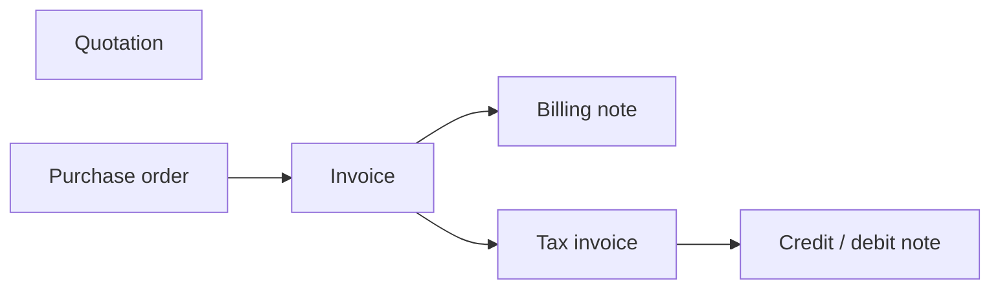

# BaiSet

**Tamper-evident Thai tax documents.**

[](https://github.com/kanokrot/baiset/actions/workflows/ci.yml)
[](LICENSE)

BaiSet is an open-source, self-hostable core for issuing Thai business
documents: quotations, purchase orders, invoices, billing notes, tax invoices,
and credit/debit notes.

## Why

After issue, the service rejects edits to document content. Credit and debit
notes can reference a tax invoice. BaiSet records lifecycle changes in a
hash-chained audit log, and its repositories provide database-level controls
for audit rows.

## Status

Early development. This repository contains a TypeScript domain core and two
persistence adapters (SQLite for development, PostgreSQL). There is no web UI,
authentication layer, or PDF rendering yet. **Not ready for production use.**

Thai Revenue Code requirements (such as the fields required by Section 86/4)
must be verified against [rd.go.th](https://www.rd.go.th) before any real use.
This project is not legal or accounting advice.

## Document flow



Arrows show supported source references, not a required workflow. Invoice and
tax-invoice source references are optional; billing notes require one or more
invoices, and credit/debit notes require one tax invoice. Delivery and payment
are not modeled document types. Draft documents can be edited; issued documents
cannot be edited through the service, though they can be voided and their status
can change. See
[docs/state-machine.md](docs/state-machine.md) for the full state machine.

## Design highlights

| Problem                  | Approach                                                                                                                                                                                               |
| ------------------------ | ------------------------------------------------------------------------------------------------------------------------------------------------------------------------------------------------------ |
| Edits after issue        | The service rejects edits unless a document is a draft. Issuance stores a canonical content hash; later status transitions such as voiding remain available.                                           |
| History tampering        | Audit entries form a SHA-256 hash chain checked by `verifyChain` against an `{entryCount, headHash}` anchor. Tests cover edits, deletions, and reordering. Optional HMAC key IDs support key rotation. |
| Gaps in document numbers | The repository assigns numbers at issue time inside a transaction, by document type and series. Tests cover concurrent issuance and rollback without consuming a number.                               |
| Rounding errors          | Money is represented as integer satang; ratio calculations use integer arithmetic. VAT rates are configurable in basis points.                                                                         |
| Equivalent Unicode text  | Canonical JSON sorts object keys and normalizes strings to Unicode NFC before content hashing. Tests cover Thai-containing strings.                                                                    |
| Maker-checker controls   | Roles are checked for each transition. A tax invoice's creator cannot issue it; tests cover this separation.                                                                                           |
| Backdated documents      | Issue dates come from an injected clock, using the Asia/Bangkok calendar by default. Tests cover date boundaries and timezone configuration.                                                           |
| Database tampering       | SQLite and PostgreSQL protect audit rows from update and deletion. PostgreSQL also creates a restricted `baiset_app` role. Repository tests check these protections.                                   |

The reasoning and known limits are written down in
[docs/threat-model-seed.md](docs/threat-model-seed.md).

## Repository layout

| Path                           | Purpose                                                         |
| ------------------------------ | --------------------------------------------------------------- |
| `packages/core`                | Domain model, state machine, numbering, validation, audit chain |
| `packages/sqlite-repository`   | SQLite adapter for development                                  |
| `packages/postgres-repository` | PostgreSQL adapter with migrations and role separation          |
| `docs/`                        | State machine and threat model                                  |

## Getting started

Requires Node.js 22+ and pnpm 10.

```bash
pnpm install
pnpm build
pnpm test
```

PostgreSQL tests use Testcontainers and need Docker.

## Quick example

This self-contained example uses an in-memory implementation of the public
`DocumentRepository` interface, following the repository used in core tests.
It creates a draft, submits it, issues it with a separate approver, and verifies
the resulting audit chain.

```ts
import { createAuditEntry, DocumentService, verifyChain } from '@baiset/core';
import type {
  AuditAnchor,
  AuditEntry,
  AuditHmacKey,
  BusinessDocument,
  DocumentRepository,
  DocumentTransaction,
  NewAuditEntry,
} from '@baiset/core';

class MemoryRepository implements DocumentRepository {
  private documents = new Map<string, BusinessDocument>();
  private entries: AuditEntry[] = [];
  private counters = new Map<string, number>();

  transaction<T>(work: (tx: DocumentTransaction) => Promise<T>): Promise<T> {
    const tx: DocumentTransaction = {
      getDocument: async (id) => this.documents.get(id),
      saveDocument: async (document) => {
        this.documents.set(document.id, document);
      },
      nextDocumentNumber: async (type, series) => {
        const key = `${type}:${series}`;
        const next = (this.counters.get(key) ?? 0) + 1;
        this.counters.set(key, next);
        return `${series}-${String(next).padStart(6, '0')}`;
      },
      appendAudit: async (entry: NewAuditEntry, key?: AuditHmacKey) => {
        const last = this.entries.at(-1);
        const created = createAuditEntry(entry, this.entries.length, last?.hash ?? null, key);
        this.entries.push(created);
        return created;
      },
      listAudit: async () => this.listAudit(),
      getAuditAnchor: async () => this.getAuditAnchor(),
    };
    return work(tx);
  }

  async getDocument(id: string): Promise<BusinessDocument | undefined> {
    return this.documents.get(id);
  }

  async listAudit(): Promise<AuditEntry[]> {
    return [...this.entries];
  }

  async getAuditAnchor(): Promise<AuditAnchor> {
    return {
      entryCount: this.entries.length,
      headHash: this.entries.at(-1)?.hash ?? null,
    };
  }
}

const repository = new MemoryRepository();
const key = 'example-audit-hmac-key-with-at-least-32-bytes';
const service = new DocumentService(
  repository,
  { vatRateBasisPoints: 700 },
  { auditHmacKey: key, auditHmacKeyId: 'example-key' },
);
const draft = {
  id: 'invoice-001',
  type: 'invoice' as const,
  series: 'A',
  currency: 'THB' as const,
  sourceDocumentIds: [],
  seller: { name: 'Seller', address: 'Bangkok', taxId: '0000000000000' },
  buyer: { name: 'Buyer', address: 'Bangkok' },
  lineItems: [
    {
      description: 'Consulting',
      quantityMilli: 1000,
      unitPriceSatang: 10000,
      vatTreatment: 'taxable' as const,
    },
  ],
};

await service.createDraft(draft, { id: 'maker', roles: ['issuer'] });
await service.submit(draft.id, { id: 'maker', roles: ['issuer'] });
const issued = await service.issue(draft.id, { id: 'approver', roles: ['approver'] });
const entries = await repository.listAudit();
const anchor = await service.exportAnchor();
if (!verifyChain(entries, anchor, { 'example-key': key })) {
  throw new Error('Audit chain verification failed');
}
console.log(issued.number, 'audit entries:', entries.length);
```

## Roadmap

Next: API layer and authentication (with a STRIDE review first), then a small
demo UI. Not planned for now: e-Tax Invoice integration, payment providers.

## ภาษาไทย

BaiSet เป็นแกนกลางโอเพนซอร์สสำหรับออกเอกสารธุรกิจไทย (ใบเสนอราคา ใบสั่งซื้อ
ใบแจ้งหนี้ ใบวางบิล ใบกำกับภาษี ใบลดหนี้/ใบเพิ่มหนี้) โดยเน้นว่าเอกสารที่ออกแล้ว
ต้องแก้ย้อนหลังไม่ได้โดยไม่ถูกตรวจพบ ตอนนี้ยังอยู่ในช่วงพัฒนาเบื้องต้น
ไม่พร้อมใช้งานจริง และรายการที่ต้องมีในใบกำกับภาษีตามมาตรา 86/4
ต้องตรวจสอบกับกรมสรรพากรก่อนนำไปใช้

## License

Apache-2.0. See [LICENSE](LICENSE).
