# BaiSet document state machine

Only drafts can be edited. Draft edits are audited without changing state. Submitting a draft moves it to approval. Issuance requires an approver, sets the issue date from the Asia/Bangkok calendar date by default (timezone configurable) and timestamps from the injected server clock, assigns the next number for the document type and series inside the same repository transaction, and stores a content hash. Callers cannot set issue or audit timestamps. Issued content is immutable.

```mermaid
stateDiagram-v2
  [*] --> draft: create
  draft --> pending_approval: submit (issuer)
  pending_approval --> issued: issue (approver; number and content hash assigned)
  issued --> voided: void (admin; reason recorded)
  issued --> adjusted: issue linked credit/debit note
```

Tax invoices cannot be edited or voided without a reason. Corrections require a credit or debit note linked to the issued tax invoice. Tax invoice maker-checker requires different creator and approver identities.

An invoice may reference a purchase order. A billing note may reference multiple invoices. A tax invoice may reference an invoice; a payment reference can be recorded as an external source identifier. Credit and debit notes must reference a tax invoice.
